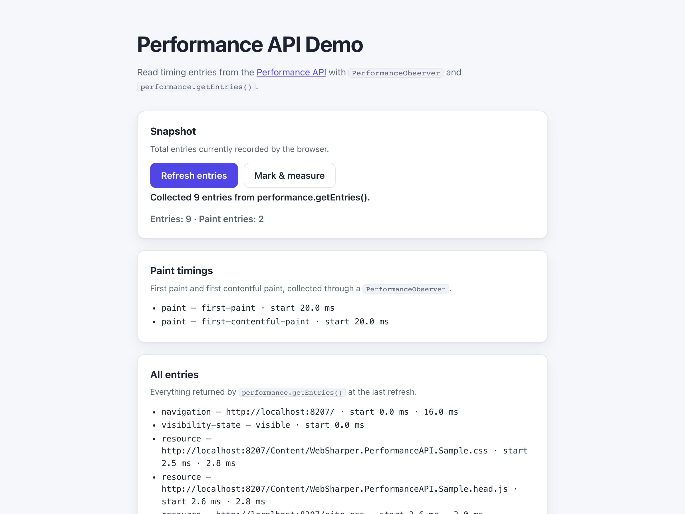

# WebSharper.PerformanceAPI

[](https://github.com/dotnet-websharper/PerformanceAPI)

WebSharper bindings for the [Performance API](https://developer.mozilla.org/en-US/docs/Web/API/Performance_API) —
reading browser timing entries, observing paint and layout metrics, and measuring custom work from F# and C# web apps.

The Performance API is available in every modern browser. It records navigation, resource, paint, layout, and
custom mark/measure entries, and it is exposed through `performance` and `PerformanceObserver`.

This repository contains:

| Project | Purpose |
| --- | --- |
| `WebSharper.Bindings.PerformanceAPI` | The binding: WIG definitions for `Performance`, `PerformanceEntry`, `PerformanceObserver`, the entry subclasses, and the `PerformanceEntry.EntryType` enum. |
| `WebSharper.PerformanceAPI` | The `[<Inline>]` client extension exposing `window.performance`. |
| `WebSharper.PerformanceAPI.Sample` | A Bundle sample that collects paint entries and prints a live timing snapshot. |

## Live demos

**Try it live:** [Open the sample in your browser](https://dotnet-websharper.github.io/PerformanceAPI/)



The sample doubles as the binding's [test case](#running-the-sample): it collects entries with `performance.getEntries()`, observes paint entries with a `PerformanceObserver`, and adds a custom mark and measure.

- **Sample (this repository):** <https://dotnet-websharper.github.io/PerformanceAPI/>
- **Source repository:** <https://github.com/dotnet-websharper/PerformanceAPI>
- **WebSharper bindings:** <https://websharper.com/bindings>

## Features

- `PerformanceEntry` (`name`, `entryType`, `startTime`, `duration`, `toJSON`) and the `PerformanceEntry.EntryType` enum.
- `PerformanceObserver` with `PerformanceObserver.Options`, `PerformanceObserver.EntryList`, `observe`, `disconnect`, `takeRecords`, and `supportedEntryTypes`.
- The entry subclasses: `PerformanceMark`, `PerformanceMeasure`, `PerformanceNavigationTiming`, `PerformanceResourceTiming`, `PerformancePaintTiming`, `LargestContentfulPaint`, `LayoutShift`, `PerformanceElementTiming`, `PerformanceEventTiming`, `PerformanceLongTaskTiming`, and `VisibilityStateEntry`.
- `performance.now()`, `timeOrigin`, `mark()`, `measure()`, `getEntries()`, `getEntriesByName()`, `getEntriesByType()`, `clearMarks()`, `clearMeasures()`, `clearResourceTimings()`, and `setResourceTimingBufferSize()`.
- `Performance.MarkOptions` and `Performance.MeasureOptions` option types.

## Installation

The binding is not currently published to NuGet. Reference the projects from source:

```bash
git clone https://github.com/dotnet-websharper/PerformanceAPI.git
```

```xml
<ItemGroup>
  <ProjectReference Include="path/to/WebSharper.Bindings.PerformanceAPI/WebSharper.Bindings.PerformanceAPI.fsproj" />
  <ProjectReference Include="path/to/WebSharper.PerformanceAPI/WebSharper.PerformanceAPI.fsproj" />
</ItemGroup>
```

## Usage

```fsharp
namespace WebSharper.PerformanceAPI.Demo

open WebSharper
open WebSharper.JavaScript
open WebSharper.PerformanceAPI
open WebSharper.PerformanceAPI.PerformanceEntries

[<JavaScript>]
module Demo =
    let report () =
        let perf = JS.Window.Performance

        perf.Mark("work-start") |> ignore
        // ... do some work ...
        perf.Mark("work-end") |> ignore
        perf.Measure("work", "work-start", "work-end") |> ignore

        for entry in perf.GetEntries() do
            Console.Log $"{entry.EntryType}: {entry.Name} at {entry.StartTime} ms"

    let watchPaint () =
        PerformanceObserver(fun (list: PerformanceObserver.EntryList) _ ->
            for entry in list.GetEntries() do
                Console.Log $"{entry.EntryType}: {entry.Name} at {entry.StartTime} ms"
        )
        .Observe(PerformanceObserver.Options(EntryType.Paint, true))
```

`window.performance` is exposed by the Extensions assembly. `PerformanceObserver.Options` maps to the
`PerformanceObserverInit` dictionary; pass `true` as the second argument to request `buffered` entries.

## Running the sample

Build the sample in Release and serve its static output:

```bash
dotnet build WebSharper.PerformanceAPI.Sample/WebSharper.PerformanceAPI.Sample.fsproj -c Release
python3 -m http.server -d WebSharper.PerformanceAPI.Sample 8100
```

Open <http://localhost:8100/>. The page refreshes the timing snapshot from `performance.getEntries()`,
shows the paint entries captured by the `PerformanceObserver`, and lets you add a custom mark and measure.

## Building from source

### Prerequisites

- [.NET SDK 10](https://dotnet.microsoft.com/download) or later.

### Build

```bash
dotnet build WebSharper.Bindings.PerformanceAPI.sln -c Release
```

The binding projects target `netstandard2.0`; the sample targets `net10.0`.

## Deployment

Pushing to `main` triggers `.github/workflows/ghpages.yml`, which builds the sample in Release and publishes
`index.html`, `site.css`, and the generated `Content/` directory to the `gh-pages` branch.

## Repository layout

```
WebSharper.Bindings.PerformanceAPI/   # binding (WIG definitions)
  Main.fs
WebSharper.PerformanceAPI/            # [<Inline>] client extensions
  Library.fs
WebSharper.PerformanceAPI.Sample/     # Bundle sample
  Client.fs
  index.html
  site.css
  Content/                            # generated at build time (gitignored)
docs/sample.png
.github/workflows/ghpages.yml         # build + deploy the sample to GitHub Pages
```

## Notes on the API

- **Observers and buffering:** `PerformanceObserver.observe()` only reports entries recorded after the observer
  starts. Pass `buffered = true` to replay entries that already happened.
- **Paint entries:** paint entries are recorded in the top-level document and are not available in cross-origin
  iframes.
- **Marks and measures:** `performance.measure(name, startMark, endMark)` takes mark names as strings and returns
  a `PerformanceMeasure`. `Performance.MeasureOptions` can be used instead when you have numeric timestamps.
- **Supported types:** `PerformanceObserver.supportedEntryTypes` lists the entry types the browser supports; some
  entries (for example `layout-shift` and `largest-contentful-paint`) are not available in every browser.
- **Extension:** `window.performance` is exposed by the Extensions assembly, so reference both projects.

## License

Apache 2.0 — see [LICENSE.md](LICENSE.md).
